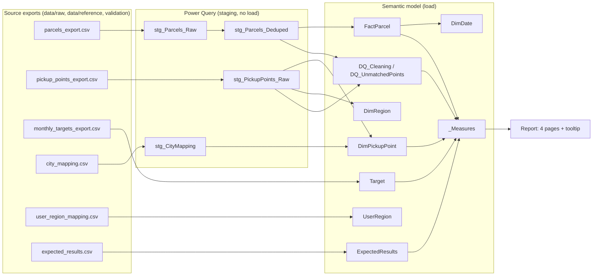

# 03 Data dictionary and lineage

> **All data is synthetic.** It is produced by `scripts/generate_data.py` (seed 42). The CSV files imitate exports from a parcel tracking system. Rerunning the script with the same seed gives identical files.

## 1. Lineage

Reads go through the `DataFolder` parameter (the repository root) and the function `fnReadCsv`, so no path is hard-coded. Every CSV is first read as text; types are set in explicit steps.

## 2. Source files

### parcels_export.csv (134,838 data rows)

One row per parcel scan-in at a point. Duplicates exist (rule R1).

| Column | Type in the file | Description | Rule |
|--------|------------------|-------------|------|
| parcel_id | text | Parcel number, `PX` plus 9 digits | Duplicate rows share the number |
| point_id | text | Pickup point, `PP-###` | May be missing from the points table (R4) |
| arrival_ts | text | Arrival at the point | Two formats (R2) |
| pickup_ts | text | Collection by the customer | Empty or `NULL` for returned parcels (R3); two formats |
| return_ts | text | Taken back for return | Empty for collected parcels; two formats |
| status | text | `Collected` or `Returned` | |
| return_reason | text | Why the parcel was returned | Empty for collected parcels |
| service_type | text | Standard, Express, Cash on delivery | |
| sender_segment | text | Large e-commerce, Marketplace seller, Small online shop, Private sender | |

### pickup_points_export.csv (90 rows)

| Column | Type in the file | Description | Rule |
|--------|------------------|-------------|------|
| point_id | text | Point number, `PP-001` to `PP-090` | Primary key |
| point_name | text | City, partner category and number | |
| point_type | text | Parcel locker or Parcel shop | |
| region | text | Central, South, West, North, East | |
| city | text | City, spelled inconsistently | Standardised (R5) |
| partner_category | text | Host business or site | |
| capacity_slots | text | Number of parcel slots | Whole number |
| opening_date | text | Opening date | Two formats (R6) |

### monthly_targets_export.csv (90 rows)

| Column | Description |
|--------|-------------|
| region | Region name |
| month | First day of the month, `yyyy-MM-dd` |
| target_parcels | Planned parcels arriving in the month |
| target_pickup_3d_rate | Planned share collected within 3 days (0.82) |
| target_return_rate | Planned share returned (0.055, 0.065 in December) |

Five regions and 18 months. The targets are a synthetic plan: actual regional volumes times a regional bias times a random factor between 0.95 and 1.05, rounded to tens.

### Reference files

| File | Content |
|------|---------|
| data/reference/city_mapping.csv | `city_key` (trimmed, lower case spelling) and the standard `city`; 35 rows |
| data/reference/user_region_mapping.csv | `user_email` and `region` for row-level security; example addresses `@example.com` |
| validation/expected_results.csv | Expected KPI values from `validation/reconcile.py`: `kpi_id`, `scope`, `scope_value`, `expected_value`, `unit` |

## 3. Model tables

| Table | Grain | Rows (v1.0) | Role |
|-------|-------|-------------|------|
| FactParcel | One parcel | 133,601 | Fact |
| DimPickupPoint | One point plus PP-UNKNOWN | 91 | Dimension |
| DimRegion | One region plus Unassigned | 6 | Dimension |
| DimDate | One day | 549 | Dimension (marked date table) |
| Target | One region and month | 90 | Fact (targets) |
| UserRegion | One user and region | 7 | Security mapping (hidden) |
| DQ_Cleaning | One cleaning step or count | 11 | Data quality |
| DQ_UnmatchedPoints | One unmatched point ID | 2 | Data quality |
| ExpectedResults | One expected KPI value | 149 | Reconciliation |
| Top N | Numbers 3 to 15 | 13 | Parameter table |
| Headline KPI | Five KPIs | 5 | Field parameter |
| _Measures | None | 0 | 30 measures |

### FactParcel columns

| Column | Type | Visible | Rule or source |
|--------|------|---------|----------------|
| ParcelId | text | yes | `parcel_id` |
| SourcePointId | text | no | `point_id` as exported |
| PointKey | text | no | `point_id`, or `PP-UNKNOWN` when not in the points table (R4) |
| ArrivalDateTime | datetime | yes | `arrival_ts` parsed (R2) |
| ArrivalDate | date | no | Date part of the arrival; links to DimDate |
| PickupDateTime | datetime | yes | `pickup_ts` parsed; null for returned parcels (R3) |
| ReturnDateTime | datetime | yes | `return_ts` parsed; null for collected parcels |
| Status | text | yes | Collected or Returned |
| ReturnReason | text | yes | `return_reason`; null for collected parcels |
| ServiceType | text | yes | `service_type` |
| SenderSegment | text | yes | `sender_segment` |
| DwellDays | decimal | yes | Days from arrival to pickup (collected) or return (returned) |
| IsCollected | whole number | no | 1 when Status is Collected |
| IsReturned | whole number | no | 1 when Status is Returned |
| IsCollectedWithin3Days | whole number | no | 1 when collected and DwellDays is at most 3 |

### DimPickupPoint columns

| Column | Type | Visible | Rule or source |
|--------|------|---------|----------------|
| PointKey | text | no | `point_id`; `PP-UNKNOWN` for the unmatched member |
| PointName | text | yes | `point_name` |
| PointType | text | yes | `point_type` |
| RegionKey | whole number | no | Looked up from DimRegion by region name |
| City | text | yes | Standard city (R5) |
| CityAsExported | text | no | City as exported, kept to count corrections |
| PartnerCategory | text | yes | `partner_category` |
| Capacity | whole number | yes | `capacity_slots`; 0 for PP-UNKNOWN |
| OpeningDate | date | yes | `opening_date` parsed (R6); null for PP-UNKNOWN |
| IsKnownPoint | true/false | no | False only for PP-UNKNOWN |

### DimRegion, DimDate, Target

| Table | Column | Type | Visible | Rule or source |
|-------|--------|------|---------|----------------|
| DimRegion | RegionKey | whole number | no | Index; also the sort order, Unassigned last |
| DimRegion | Region | text | yes | Distinct regions of the points export plus Unassigned |
| DimDate | Date | date | yes | One row per day from the first day of the first month to the last day of the last month in the parcel data; key |
| DimDate | Year, Quarter, MonthName, YearMonth, WeekdayName, IsWeekend, Season | mixed | yes | Calendar attributes; MonthName sorts by month number, WeekdayName by ISO weekday |
| DimDate | MonthNumber, MonthStart, WeekdayNumber | mixed | no | Sort and helper columns |
| Target | RegionKey, MonthStart | mixed | no | Foreign keys to DimRegion and DimDate |
| Target | TargetParcels, TargetPickup3dRate, TargetReturnRate | number | no | Used only through measures |

## 4. Data quality issues and their handling

Counts are from `validation/reconcile.py` and are shown live on the Data quality page.

| ID | Issue (planted on purpose) | Rows affected | Handling | Power Query step |
|----|----------------------------|--------------:|----------|------------------|
| R1 | Exact duplicate rows in the parcel export (a re-run export) | 1,237 | Removed; keep the first occurrence | `R1 Remove exact duplicate rows` in `stg_Parcels_Deduped` |
| R2 | Two timestamp formats: `yyyy-MM-dd HH:mm:ss` and `dd.MM.yyyy HH:mm:ss` | 5,428 rows use the dotted format | Parsed with an explicit format per pattern; nothing dropped | `R2 Parse mixed timestamp formats` using `fnParseTimestamp` |
| R3 | Returned parcels have no pickup time, written as empty text or the text `NULL` | 6,700 | Converted to a real null; kept. Dwell time of a returned parcel ends at the return time. | `R3 Blank and NULL text to null` using `fnNullIfEmpty` |
| R4 | Point IDs in the parcel export that are not in the points table (PP-091: 227 rows, PP-092: 230 rows; both closed in March 2025) | 457 | Kept so that totals match the source; mapped to `PP-UNKNOWN` in region Unassigned; listed in DQ_UnmatchedPoints | `R4 Map unmatched point IDs to PP-UNKNOWN`; `R4 Add PP-UNKNOWN member` |
| R5 | Inconsistent city spelling in the points export (case, missing diacritics, English names such as Warsaw and Cracow, trailing spaces) | 47 of 90 points | Trimmed, lower-cased and looked up in `city_mapping.csv`; unknown spellings fall back to proper case | `R5 Standardise city spelling` |
| R6 | Two date formats for the opening date: `yyyy-MM-dd` and `dd.MM.yyyy` | 18 of 90 points | Parsed with an explicit format | `R6 Parse mixed opening dates` using `fnParseDate` |

Row counts: 134,838 rows read, 1,237 duplicates removed, 133,601 rows in the fact table.

Why this order: R1 runs first on the untouched text, because a duplicate is defined as equal in all nine columns. R3 runs before R2 so that `NULL` text never reaches the date parser.

Issues that were **not** planted and are not handled: time-zone changes, parcels that are still waiting at export time (none, see assumption A5 in doc 01), and misspelt service types.

## 5. How to answer "where does the data come from?"

The data does not come from a real carrier. It is synthetic and generated by a seeded script in this repository. The script models weekly rhythm (busy Tuesday to Thursday, quiet Sunday), a November-December peak with Black Friday spikes, lockers that collect faster than shops, a few overloaded points and a few underused points, and a region (West) that collects slowly. The shape of the three exports (parcels, points, targets) follows what a pickup network's tracking system typically provides. Problems were added on purpose so that Power Query has real work to do and the documentation can record it.
