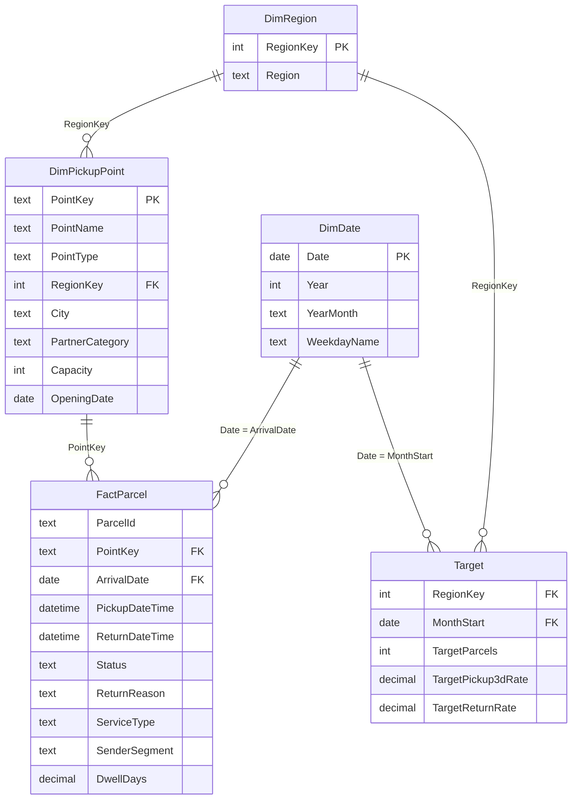

# 04 Data model

The semantic model is stored as TMDL files in `PickupNetwork.SemanticModel/definition/`.

## 1. Diagram

Tables without relationships (by design): `_Measures`, `Top N` and `Headline KPI` (parameters), `UserRegion` (used inside the security rule), `ExpectedResults`, `DQ_Cleaning` and `DQ_UnmatchedPoints` (reconciliation, filtered with `TREATAS` or `CALCULATE`).

## 2. Star schema, with one shared dimension

`FactParcel` is the main fact table. Its dimensions are `DimPickupPoint` and `DimDate`. Region sits in its own small table, `DimRegion`, because both points and targets belong to a region. That makes a light snowflake (fact, point, region) instead of a pure star, which I accepted for two reasons: targets exist per region and month, so they need a region dimension of their own; and one region table gives one slicer and one place for row-level security. The alternative, repeating the region in the target table and the point table and relating the two text columns, would create two region columns that can disagree.

## 3. Relationships

All relationships are many-to-one, single direction (dimension filters fact), and active.

| From (many) | To (one) | Cardinality | Notes |
|-------------|----------|-------------|-------|
| FactParcel[PointKey] | DimPickupPoint[PointKey] | many to one | Every fact row has a match because unmatched IDs are mapped to `PP-UNKNOWN` |
| FactParcel[ArrivalDate] | DimDate[Date] | many to one | The only date relationship; pickup and return dates are attributes, not axes |
| DimPickupPoint[RegionKey] | DimRegion[RegionKey] | many to one | |
| Target[RegionKey] | DimRegion[RegionKey] | many to one | |
| Target[MonthStart] | DimDate[Date] | many to one | Targets sit on the first day of each month |

Key columns (`PointKey`, `RegionKey`, `ArrivalDate`, `MonthStart`) are hidden. `DimDate[Date]` stays visible because it is the date table's key.

Why single direction: both-direction filtering can create ambiguous paths and slow queries. No measure in this model needs a fact table to filter a dimension.

## 4. Grain

| Table | One row is |
|-------|-----------|
| FactParcel | one parcel at one pickup point |
| DimPickupPoint | one pickup point (plus one `PP-UNKNOWN` row) |
| DimRegion | one region (plus Unassigned) |
| DimDate | one calendar day |
| Target | one region in one month |

## 5. Date table

`DimDate` is built in Power Query. It starts on the first day of the month of the earliest arrival (1 July 2024) and ends on the last day of the month of the latest arrival (31 December 2025), 549 days, with no gaps. It is marked as the date table (`dataCategory: Time`, key column `Date`), and Power BI's automatic date hierarchies are switched off (`__PBI_TimeIntelligenceEnabled = 0`), so time intelligence uses this table only.

Why Power Query and not DAX: the table is a plain list of dates and attributes, it is a fact of the model rather than a calculation, and it loads once. Building it from the parcel data keeps it in step with the data without a typed start date.

Special features:

- `MonthName` sorts by `MonthNumber`, `WeekdayName` by `WeekdayNumber` (Monday first).
- `Season` marks November and December as the peak.
- Because the data starts in July 2024, year-to-date for 2024 covers July to December, and previous-year measures are blank before July 2025.

## 6. Handling of unmatched points

Parcels whose point ID is not in the points table keep their place in `FactParcel`. They point to `PP-UNKNOWN`, which belongs to the region `Unassigned` and has capacity 0 and no opening date. Reasons: removing them would make totals differ from the source system, and a missing dimension row is a data problem to show, not to hide. The cost is one extra region in slicers; the Data quality page says why.

## 7. Row-level security

Role: `Regional Manager`, permission `read`.

| Table | Filter |
|-------|--------|
| DimRegion | `DimRegion[Region] IN SELECTCOLUMNS(FILTER(UserRegion, UserRegion[Email] = USERPRINCIPALNAME()), "Region", UserRegion[Region])` |
| UserRegion | `UserRegion[Email] = USERPRINCIPALNAME()` |
| ExpectedResults, DQ_Cleaning, DQ_UnmatchedPoints | `FALSE()` (network-wide figures are hidden from regional managers) |

Design: dynamic security with a mapping table. One user can have several regions (the example address `north.east.manager@example.com` has two). The filter on `DimRegion` flows to the points, targets and, through the points, to the parcels. Unassigned is not in the mapping, so regional managers do not see it.

Consequences to know:

- `Parcels % of Network` (which uses `ALL`) cannot escape row-level security: for a regional manager the network is their region(s).
- The reconciliation page shows no rows for a regional manager, because the expected values are network-wide.
- A user who is in no role sees everything. In the Power BI service, assign the role to the regional managers' group; the head of the network does not get the role.
- Test: in Power BI Desktop use Modeling, View as, tick `Regional Manager`, choose Other user, enter `north.manager@example.com`. Only North appears.

## 8. Settings worth knowing

| Setting | Value | Why |
|---------|-------|-----|
| `discourageImplicitMeasures` | on | Forces the use of the explicit measures, so numbers are defined in one place |
| Auto date/time | off | One date table only |
| Query groups | Parameters, Functions, Staging | Keeps the query list readable |
| Format strings | set on all numeric measures | Consistent display |
| Display folders | 1 Volumes to 9 Reconciliation | Navigation in the field list |
